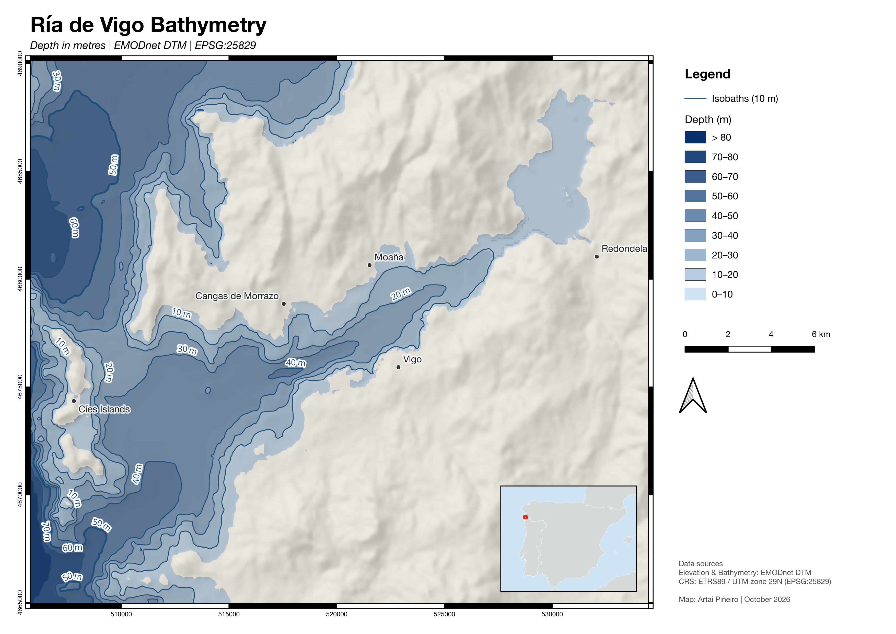

# Ría de Vigo Bathymetry

Bathymetric map of the Ría de Vigo (Galicia, Spain) built in QGIS from open EMODnet data.

## Problem

Public bathymetric data for the Ría de Vigo exists, but only as a raw grid in geographic coordinates: you can't measure, read or print it as it is. This project turns it into a print-ready map in the official Spanish CRS, with isobaths, hillshade and the information needed to reuse it safely: vertical datum, data version, licence and limits.

## Data

| Dataset | Source | Licence |
| --- | --- | --- |
| Bathymetry and land elevation | EMODnet Digital Bathymetry (DTM 2024), layer `emodnet:mean` | CC BY 4.0 |
| Place names | Digitised by the author; names from the [Nomenclátor de Galicia 2026](https://xunta.gal/es/toponimia-e-nomenclator) | - |
| Inset map | QGIS built-in world map (Natural Earth) | Public domain |

- **Citation:** EMODnet Bathymetry Consortium (2024). EMODnet Digital Bathymetry (DTM 2024). https://doi.org/10.12770/cf51df64-56f9-4a99-b1aa-36b8d7b743a1
- **Original grid:** 1/16 arc-minute cells (about 86 × 116 m at this latitude), EPSG:4326.
- **Vertical datum:** depths relative to Lowest Astronomical Tide (LAT).
- **Not for navigation.** Use the official charts of the Instituto Hidrográfico de la Marina instead.

## Method and decisions

Processed in QGIS 3.44 with its GDAL tools. Exact parameters come from Processing → History.

1. **Reprojection** to ETRS89 / UTM zone 29N (EPSG:25829): `gdalwarp -r bilinear -tr 100 100`
    - ETRS89 / UTM 29N is the official system in Spain. Galicia lies in zone 29, close to its central meridian, so scale distortion is negligible and distances are in metres.
    - Bilinear resampling, because depth is a continuous variable: every new value lies between the original ones. Cubic can overshoot near steep slopes and the coastline.
    - 100 m cells: the original cell (≈ 86 × 116 m) covers about 10,000 m², so 100 × 100 m keeps the same information density without faking detail.
2. **Hillshade**: `gdaldem hillshade -z 3 -s 1 -az 315 -alt 45`
    - Light from the north-west (315°), the cartographic convention, to avoid relief inversion (valleys reading as ridges).
    - Vertical exaggeration ×3, because the seabed slopes are very gentle. It is stated on the map.
    - `-s 1` scale is valid only because the grid is already in metres; in EPSG:4326 it would need `-s 111120`.
3. **Isobaths**: `gdal_contour -i 10`, then *Extract by expression* `"ELEV" < 0`
    - 10 m interval: 100 m cells averaged from several surveys don't support finer contours, and it gives about eight readable isobaths.
    - The DTM includes land, so contours above sea level (1,307 lines up to +680 m) were removed; 40 isobaths remain.
    - Smoothing (3 iterations, offset 0.25) removes the pixel stair-steps. It is cosmetic: the depth grid is unchanged.
    - Labels show depth as a positive value: `abs(to_int("ELEV")) || ' m'`.
4. **Layout**
    - Sequential blue ramp, darker meaning deeper, with 10 m classes matching the isobaths.
    - Land in grey with hillshade, as context that doesn't compete with the water.
    - Place names: specific part in its official Galician form (see Data), generic part in English (Cíes Islands, San Simón Bay). *Ría de Vigo* is kept whole: it is the established name in English, and *ria* is the English term for this landform.
    - The map states CRS, vertical datum, data version and DOI, licence, vertical exaggeration and a not-for-navigation warning.
    - Exported as PNG at 300 dpi and as PDF with text kept as text.

## Result

- [Map, PNG 300 dpi](maps/vigo_ria_bathymetry.png) and [map, PDF](maps/vigo_ria_bathymetry.pdf)
- [Depth grid](data/processed/vigo_ria_emodnet_25829.tif): GeoTIFF, 100 m cells, EPSG:25829
- [Isobaths every 10 m](data/processed/vigo_ria_emodnet_25829_isobaths_10m_smooth.gpkg): GeoPackage
- [QGIS project](project/vigo_ria.qgz) with all layers and the layout

## How to reproduce

1. Clone this repository and open `project/vigo_ria.qgz` in QGIS 3.44 or later. Layer paths are relative, so everything loads as is.
2. To start from scratch, use the original grid in `data/raw/`, or download the layer `emodnet:mean` from the EMODnet WCS service (https://ows.emodnet-bathymetry.eu/wcs) clipped to 8.9365–8.5741° W, 42.0867–42.3658° N. Then repeat the steps in *Method and decisions*.

## Limitations

- Each 100 m cell stores the mean of several surveys, so features smaller than about 200–300 m, such as rocks or shoals, can disappear. Not suitable for hazard detection or mooring design.
- The coastline is stair-stepped in narrow intertidal areas, such as San Simón Bay, because of the cell size.
- The WCS service always serves the latest DTM release. The grid used here is kept in `data/raw/`, so this exact map can be reproduced.

## AI-assisted workflow

I used an AI assistant (Claude) as a tutor: it explained and sometimes demonstrated each step, and I repeated and ran every step myself. I log the assistant's mistakes and how they were caught. Three from this project:

- It placed the `-tap` option under *Advanced Parameters* of the QGIS Warp tool. In QGIS 3.44 it isn't there: it goes in *Additional command-line parameters*. Lesson: check the interface itself, not a description of it.
- It pointed to a single tile's record to cite the data, and the layer information in QGIS showed release 2022. Querying the WCS service confirmed that `emodnet:mean` is the DTM 2024. Lesson: verify the data version on the layer itself before citing it.
- It claimed the official name of the municipality was "Cangas", based on secondary sources. The 2026 Galician Nomenclátor says "Cangas de Morrazo". Lesson: check place names in the current official gazetteer.
