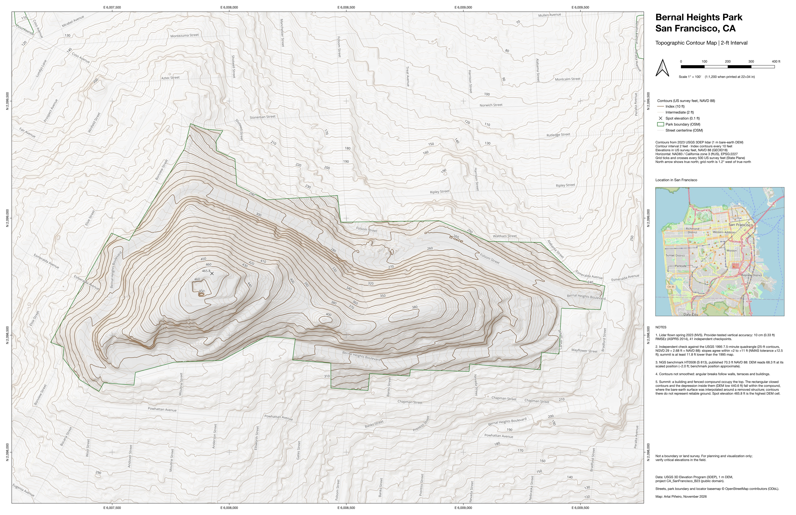

# Bernal Heights Park 2-ft Contours

Topographic contour map of Bernal Heights Park (San Francisco, CA) from 2023 USGS 3DEP lidar, delivered in California State Plane feet on an ANSI D sheet at 1" = 100'.

## Problem

US site-design and engineering work (landscape plans, grading studies, permit drawings) needs contours in State Plane coordinates and US survey feet, referenced to NAVD 88. USGS publishes 1 m lidar elevation models for free, but in UTM metres and as a raw grid: they can't be dropped into a site plan as they are. This project turns one 3DEP tile into a validated 2-ft contour map and a clean GeoPackage that a client can open directly in QGIS, ArcGIS or Civil 3D.

## Data

| Dataset | Source | Licence |
| --- | --- | --- |
| Elevation | USGS 3DEP 1 m DEM, project `CA_SanFrancisco_B23`, tile `x55y418` | Public domain |
| Independent check | USGS Historical Topographic Map *San Francisco South* 1995, 1:24,000 (25-ft contours) | Public domain |
| Benchmark | NGS datasheet HT0508 (S 813), 70.3 ft NAVD 88 | Public domain |
| Streets and park boundary | OpenStreetMap | ODbL |
| Locator basemap | OpenStreetMap standard tiles | ODbL |

- **Found with** the TNM Access API (https://tnmaccess.nationalmap.gov/api/v1/products): `datasets=Digital Elevation Model (DEM) 1 meter`, `bbox=-122.4185,37.7395,-122.4110,37.7455`. The overlapping project `CA_CaliforniaGaps_B23` was rejected: it has no data over the park.
- **Lidar:** flown spring 2023 by NV5. Provider-tested vertical accuracy 10 cm (0.33 ft) RMSEz, ASPRS 2014, 41 independent checkpoints (30 NVA + 11 VVA).
- **Original CRS:** NAD83(2011) / UTM zone 10N, metres; heights NAVD 88 (GEOID18), metres. Datum realisation and geoid from the vendor metadata; the GeoTIFF itself is tagged EPSG:26910 (NAD83).
- **Delivered CRS:** NAD83 / California zone 3 (ftUS), EPSG:2227; heights NAVD 88 in US survey feet.
- **OpenStreetMap** extract downloaded in November 2026 with the QuickOSM plugin (Overpass API): `leisure=park` (multipolygons) and `highway=*` (lines), intersecting the DEM extent.

## Method and decisions

Processed in QGIS 3.44 with its GDAL tools. Exact parameters come from Processing → History.

1. **Clip** to the park and surrounding streets: `gdal_translate -projwin 551150 4177850 552200 4177150` (UTM 10N metres, 1,050 × 700 m).
2. **Reprojection** to EPSG:2227: `gdalwarp -t_srs EPSG:2227 -r bilinear -tr 3 3`
    - Bilinear resampling, because elevation is continuous.
    - 3 ft cells (0.91 m) keep the detail of the 1 m source without inventing any.
3. **Units**: metres to US survey feet with the Raster Calculator, `"bernal_heights_dem_2227_z_m_v2@1" * 3937 / 1200`. The US survey foot (1200/3937 m) is the unit of EPSG:2227; the international foot (0.3048 m) would shift heights by 2 ppm.
4. **Exact statistics** before contouring: `gdalinfo -stats` (min 23.66 ft, max 465.85 ft).
    - `gdal_contour` picks its levels from the stored statistics. With the default approximate ones, the lowest (24 ft) and highest (464 ft) contours were silently missing.
5. **Contours**: `gdal_contour -i 2 -a elev_ft`, 816 lines from 24 to 464 ft. Index contours every 10 ft.
    - Not smoothed, on purpose: at 2 ft the angular breaks are real walls, terraces and building edges, and smoothing would move contours off the measured surface.
6. **Hillshade**: `gdaldem hillshade -z 1 -az 315 -alt 45`. Horizontal and vertical units are both US survey feet, so no scale factor is needed.
7. **Spot elevation**: the highest DEM cell (6,007,926.29 E, 2,098,763.66 N), sampled with *Sample raster values*: 465.8 ft.
8. **Layout**: ANSI D (22 × 34 in) at 1" = 100'.
    - Text no smaller than 10 pt.
    - North arrow set to true north; grid convergence here is 1.2°.
    - Outside the park, contours are faded by a semi-transparent white mask. The transparency is set on the fill colour, not the layer, so the mask and the contours stay vector in the PDF.
9. **Export** from the layout:
    - PDF: contours, streets, grid and text as vectors (text searchable); hillshade and locator map as embedded images. Georeferenced in EPSG:2227.
    - JPG preview: a 300 dpi PNG export resized to 150 dpi (5100 × 3300 px, quality 85) with `scripts/make_preview_jpg.py`. The PNG is not kept in the repository.
10. **Deliverable GeoPackage** (`deliverables/bernal_heights_contours_2227.gpkg`), built with *Refactor fields*:
    - `contours`: `elev_ft` as integer and a new `contour_type` field, `CASE WHEN "elev_ft" % 10 = 0 THEN 'index' ELSE 'intermediate' END`.
    - `spot_elevations`: `elev_ft` rounded to 0.1 ft.
    - From the OSM extract: `streets` reprojected to EPSG:2227, keeping `name`, `highway`, `osm_id` and `osm_type`; `park_boundary` with Bernal Heights Park only, keeping `name`, `osm_id` and `osm_type`.
    - Contours, spot elevation and streets on the map are drawn from this GeoPackage, so the map shows exactly the delivered data.

## Validation

1. **Completeness**: the lowest contour (24 ft) is the first even value above the DEM minimum (23.66 ft), and the highest (464 ft) the last below the maximum (465.85 ft). The 221 levels are exactly (464 − 24) / 2 + 1, so no level is missing.
2. **USGS 1995 quadrangle** (*San Francisco South*, 25-ft contours, NGVD 29, NAD27 converted to NAD83 with NADCON5). Heights converted with NGVD 29 + 2.68 ft = NAVD 88 (NGS datasheet HT0508).
    - Slopes: the DEM is 2 to 11 ft above the 1995 contours, within the NMAS tolerance of ±12.5 ft (half the 25-ft interval).
    - Summit: the highest closed contour in 1995 is 475 ft NGVD 29; the DEM maximum is 463.2 ft NGVD 29. The lidar summit is at least 11.8 ft lower, at the edge of the tolerance.
3. **NGS benchmark HT0508 (S 813)**: published 70.3 ft NAVD 88; the DEM reads 68.3 ft at its position scaled from the 1995 map (−2.0 ft). The scaled position is approximate, and on a slope a few metres of position error explain the difference.
4. **Summit anomaly**: rectangular closed contours and a 20-ft depression (DEM low 440.6 ft) sit on a building and fenced compound, confirmed on aerial imagery. The bare-earth surface there was interpolated by the provider around a removed structure, so those contours are flagged on the map as unreliable instead of being edited.

## Result

- [Map, PDF](maps/bernal_heights_contours_ansi_d.pdf): ANSI D, vector contours and searchable text, georeferenced in EPSG:2227. [Preview, JPG 150 dpi](maps/bernal_heights_contours_ansi_d.jpg).
- [GeoPackage](deliverables/bernal_heights_contours_2227.gpkg), EPSG:2227, heights in US survey feet NAVD 88:

| Layer | Geometry | Features | Fields |
| --- | --- | --- | --- |
| `contours` | LineString | 816 | `elev_ft` (integer), `contour_type` (`index` / `intermediate`) |
| `spot_elevations` | Point | 1 | `elev_ft` (0.1 ft) |
| `park_boundary` | MultiPolygon | 1 | `name`, `osm_id`, `osm_type` |
| `streets` | LineString | 337 | `name`, `highway`, `osm_id`, `osm_type` |

- [Elevation grid](data/processed/bernal_heights_dem_2227_z_ftus_v2.tif): GeoTIFF, 3 ft cells, EPSG:2227, NAVD 88 US survey feet.
- [QGIS project](project/bernal_heights_contours.qgz) with all layers and the layout.

## How to reproduce

1. Clone this repository and open `project/bernal_heights_contours.qgz` in QGIS 3.44 or later. Layer paths are relative.
2. The source data is not in the repository (`data/raw/` is git-ignored because of its size), so two layers will show as missing:
    - DEM tile `USGS_1M_10_x55y418_CA_SanFrancisco_B23.tif`: use the TNM Access API query in *Data*.
    - 1995 quadrangle `CA_San_Francisco_South_1995_24000_geo.tif`: same API, `datasets=Historical Topographic Maps`, `prodExtents=7.5 x 7.5 minute`.
3. Save both in `data/raw/` and repeat the steps in *Method and decisions*.

## Limitations

- **Bare-earth surface, not a survey.** Under buildings and dense vegetation the provider interpolated the ground, so contours there (for example the summit compound) don't show real terrain. Not a substitute for a field survey before design or construction.
- **Accuracy.** Under the ASPRS 1990 Class 1 rule, RMSEz must not exceed one third of the contour interval: 2 ft contours need RMSEz ≤ 0.67 ft (20.3 cm). This lidar is tested at 10 cm, so the 2-ft interval is well within its accuracy.
- **Date.** The terrain is as of spring 2023; later earthworks are not shown.
- **Horizontal datum.** The source is NAD83(2011) and EPSG:2227 is labelled NAD83. No transformation was applied between them, so coordinates are effectively NAD83(2011).
- **OpenStreetMap layers** are community-mapped, with positional errors of a few metres. The park boundary is not the official City of San Francisco parcel.

## AI-assisted workflow

I used an AI assistant (Claude) as a tutor: it explained and sometimes demonstrated each step, and I repeated and ran every step myself. I log the assistant's mistakes and how they were caught. Four from this project:

- It audited the layout by rendering it to PNG and declared it ready. The exported vector PDF lost the mask's layer opacity and hid every contour outside the park. Lesson: check the final file, not a simulation of it.
- It said the sampled elevation field would be `elev_ft_1`; QGIS wrote `elev_ft1`. Lesson: read the real schema with `ogrinfo` before writing expressions or documentation.
- It gave a keyboard shortcut for the degree sign that doesn't work on a Spanish Mac keyboard. The note was saved without the ° until a render of the saved project caught it, before export. Lesson: verify the interface itself, and re-read rendered text.
- It checked the spot-elevation label after changing the layer's data source, but not the copy of the style locked in the layout. The label vanished from the map without any error until a render of the saved project caught it. Lesson: with locked layout styles, check both the layer and the layout.
